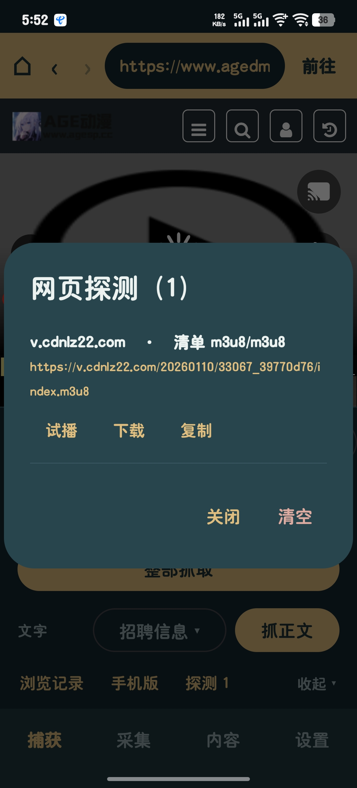

# 梼杌 (taowu-android)

<p align="center">
  
</p>

> 一个安卓上的**网页视频/动漫抓取 & 下载**工具。内置浏览器走到要抓的页面，点一下按钮，
> 自动解析出 m3u8 / mp4 / DASH 流并下载成能播的本地文件。
>
> 本项目是 PC 版 **梼杌 v2.1**（Python + Qt）的安卓移植版，把解析引擎、下载栈、解密、
> 配方系统整套搬到了 Android（Kotlin + Jetpack Compose + Media3）。

- 包名：`com.taowu`
- 当前版本：`5.6`（versionCode 38）
- 最低系统：Android 8.0（API 26）；目标 SDK 37

---

## 目录

- [它能做什么](#它能做什么)
- [界面与全套使用方法](#界面与全套使用方法)
  - [① 捕获页（内置浏览器）](#-捕获页内置浏览器)
  - [② 解析页](#-解析页)
  - [③ 分集列表](#-分集列表)
  - [④ 整部抓取](#-整部抓取)
  - [⑤ 内容页（已下载 / 播放）](#-内容页已下载--播放)
  - [⑥ 设置页](#-设置页)
- [抓取流水线（原理）](#抓取流水线原理)
- [配方（站点规则）](#配方站点规则)
- [配方编写文档](#配方编写文档)
- [抓取参数一览](#抓取参数一览)
- [构建与打包](#构建与打包)
- [项目结构](#项目结构)
- [技术栈](#技术栈)
- [常见问题](#常见问题)
- [已知限制](#已知限制)

---

## 它能做什么

- **通用模式**：不挑站。给一个网页地址，程序自己扫页面里的 m3u8 / mp4 / DASH 地址（页内八趟静态扫描 + 混淆解码 + iframe 深挖）。
- **配方模式**：给特定站写一份 JSON 规则，按接口 / 页面结构精准取流。
- **单集解析**：一个播放页 → 出若干条候选轨道（不同线路 / 清晰度）。
- **分集列表**：一个详情页 → 自动认出整部番的所有线路与集数。
- **整部抓取**：一键把整部番（可多线路、多集并行）抓下来，支持随时停止。
- **HLS / DASH 下载**：分片并发下载，支持 AES-128 / AES-256 / AES-256-CTR / cbcs 解密、DASH CENC / ClearKey。
- **直链下载**：Range 多连接加速 + 断点续传（`.part` / `.idx`）。
- **音频 / 视频合流**：分轨（DASH 视频 + 音频）用 Media3 Transformer 合成单文件。
- **在线播放**：下载前可直接在线试播；下载后在「内容」页离线播放，完整播放器（进度、选集、横屏）。
- **后台抓取**：前台服务保活，退到后台 / 关界面不停，通知栏显示进度、可一键停止。

---

## 界面与全套使用方法

底部四个主栏：**捕获 / 采集 / 内容 / 设置**。

### ① 捕获页（内置浏览器）

捕获页就是一个**内置浏览器**，用来走到你要抓的页面：

```
┌──────────────────────────────────────┐
│ [ 输入网址…               ] [前往]     │  ← 金色地址栏（永远可见）
│                                       │
│            网页（WebView）             │
│                                       │
├──────────────────────────────────────┤
│ 模式                   [通用模式 ▾]    │  ← 模式切换
│ [解析] [分集列表]                      │
│ [        整部抓取         ]            │
│ 浏览记录                    收起 ▾      │
└──────────────────────────────────────┘
```

**用法**：在地址栏输入网址 → 点「前往」→ 浏览到要抓的页面 →（可选）在下拉框选 **通用模式 / 配方模式** → 点下方三个按钮之一。

- **地址栏**：输 `xxx.com` 会自动补 `https://`；键盘上的「前往 / Go」也能提交。页面跳转（点链接、点分集）时地址栏**自动更新**为当前页地址（只有当光标停在地址栏里打字时不覆盖）。
- **模式下拉**：
  - **通用模式**：页内扫描，任意站可用（默认）。
  - **配方模式**：用站点配方规则（内置 / 用户导入的 JSON）取流。
- **三个按钮**（对**当前浏览到的网页**生效）：
  - **解析** → 进「解析页」，出候选轨道。
  - **分集列表** → 进「分集列表页」，列出线路与集数。
  - **整部抓取** → 进「整部抓取页」，批量下载。
- **可收起的面板**：底部面板右下「收起 ▾」可整块收起，把屏幕全让给网页（网页底部弹窗就不会被挡）。收起后**顶部地址栏右侧出现 `抓取 ▴`**，点它再展开。
- **浏览记录**：底部面板左下「浏览记录」→ 弹出历史列表（最近在最前，最多 60 条，本地持久化）。点一条直接跳转，可单条删除或清空。
- **系统返回键**：在网页内后退，不会直接退出 App。

> 想抓的页面藏在站内搜索 / 列表里时，直接在浏览器里点进去即可，不用手抄 URL。

### ② 解析页

对当前页面跑「通用模式」或「配方模式」解析，列出拿到的候选轨道：

- 每条轨道显示 **清晰度 / 格式 / 大小（若可得）/ 归属**。
- 顶部显示 `route = … · 各步说明`（如 `通用静态扫描`、`配方:xxx`、`页面获取失败`），用来判断失败原因。
- 点某条轨道 → 进播放页（在线试播）。
- 页面底部通常有 **「整部抓取」** 入口，可跳到整部。

### ③ 分集列表

识别当前页属于哪部番，列出**线路 × 集数**：

- 每集一条，显示集号与线路。
- 可单集点进播放 / 下载。
- 也可直接跳到「整部抓取」。

### ④ 整部抓取

把整部番批量抓下来：

- 顶部列出每集状态（等待 / 抓取中 / 完成 / 失败）与总进度。
- 底部主按钮：没任务时是 **「整部抓取 / 重新整部抓取」**，有任务在跑时变成红色 **「停止抓取（已完成/总数）」**，点了随时停。
- 「内容」页的实时进度卡片、解析页状态行、**通知栏**里也各有一个「停止」，哪儿都能停。

**停止是协作式取消**：当次网络请求不会被硬打断，等它返回后在下一个检查点停下（HLS 通常是当前这一批分片，几秒内）。停止后前台通知自动撤掉。

### ⑤ 内容页（已下载 / 播放）

- **正在下载**卡片：显示当前任务标题、`已完成/总数`、当前步骤、实时速度，右上角可「停止」。
- **已下载**列表：列出已完成的文件，点击播放。
- **播放页**：完整播放器（进度、选集列表在视频下方、横屏、记忆播放位置）。

### 采集页（文字采集结果）

把网页上的**结构化字段**（标题/作者/发布时间/正文/价格… 按行业模板）抽成一张表 —— 移植自 PC 版的"文字抓取"。

- **怎么采**：在「捕获」浏览器里浏览到目标页 → 底部面板选 **字段模板** → 点 **「抓正文」**，当前页就抽成一条，累加到采集结果（可逐页采集，对应 PC 版的半自动批量）。
- **采集页**：列出所有结果（一行一个页面），可 **单条删 / 清空 / 导出 CSV / 导出 JSON**（用系统文件选择器存你选的位置）。
- **内置模板**：新闻资讯 / 电商商品 / 企业工商 / 房产租售 / 招标采购 / 政策文件 / 学术文献 / 专利/商标 … 共 **15 套**（走通用字段引擎，配套字段规则 15 套）；外加 **招聘信息**（走招聘专用正则抽取器，engine=recruit：企业名称/岗位/地点/薪资/学历/经验/职责/福利/联系方式）。
- **规则**：`【标签】值` 与 `标签：值` 两种形态对位 → 逐列按「列名/同义词」查表 → 取不到再按形态兜底（金额/日期/电话/链接/长文本）。

### ⑥ 设置页

顶部标签栏八个页签：

| 页签 | 内容 |
|---|---|
| **媒体配方** | 查看内置配方、导入 / 删除用户配方（JSON） |
| **解析** | 跳转层数、静态扫描开关、跟随 iframe、超时、重试次数/退避、混淆解码开关/轮数、分集识别门槛、额外分集链接正则、广告过滤（开关 + 额外关键字） |
| **下载** | 分片并发、整部并行集数、重试、Range 分段数/触发大小、分片超时、解密方式 |
| **节流** | 全局/单 host 并发上限、自适应并发开关 |
| **请求头** | 全局 User-Agent、附加 Referer 覆盖 |
| **后处理** | 视频元数据打标开关 |
| **播放** | 视频解码：自动（硬解优先，软解兜底）/ 强制软解 / 仅硬解 |
| **字段模板** | 文字采集的默认模板、采集上限；导入 / 删除用户模板与规则片段 |

每页底部有 **「恢复全部默认」**。

---

## 抓取流水线（原理）

```
输入 URL
  │
  ├─ 配方模式 ──▶ 命中配方(host_suffix) ──▶ 跑 steps 取数据 ──▶ emit 产出 Track
  │                                        （未命中/未产出 → 提示换通用模式）
  │
  └─ 通用模式 ──▶ 抓页面 ──▶ 八趟静态扫描
                     │            ├─ 明文 m3u8/mp4/dash 直链
                     │            ├─ 混淆解码（base64↔URL 多重编码，MacCMS encrypt 系）
                     │            ├─ <video>/<source>/data-* 等
                     │            └─ iframe / meta-refresh / 分集页 深挖（跳数上限）
                     ▼
                 Track[]（候选轨道）
                     │
                     ▼
              Downloader 逐条下载
                 ├─ HLS：拉清单 → 并发下分片 → 按 #EXT-X-KEY 解密 → 拼接
                 ├─ DASH：拉 MPD → 视频/音频分轨 → 合流（Media3 Transformer）
                 └─ 直链：Range 多连接分段 + 断点续传（.part/.idx）
                     │
                     ▼
              落盘（命名规整 + 可选元数据 .info.json）→ 内容页可离线播放
```

**关键点**

- **多重编码解码**：MacCMS `player_aaaa` 的 `url` 常是 `base64(URL编码(真实地址))`（`encrypt:2`），程序会**迭代解码到稳定**，把真实 m3u8 还原出来。
- **403 归因**：请求被拒时区分「需要 Referer / Cookie / 防盗链」，便于定位。
- **自适应并发**：全局 + 单 host 双层闸门，按吞吐自动升降，避免把 CDN 打死。
- **断点续传**：中途退出 / 失败后重跑，从已下部分继续。

---

## 配方（站点规则）

配方是**数据不是代码**——一份 JSON 描述某个站「怎么取流」。内置配方在 `src/main/assets/recipes/`，
用户配方放在 App 私有目录（设置 → 媒体配方 里导入，升级不覆盖）。

### 内置配方

| 文件 | 站点 |
|---|---|
| `age_anime.json` | age 动漫（agedmani.com，MacCMS + `a_0001` 模板） |
| `girigirilove.json` | girigiri 愛動漫（只提供分集形状，取流靠通用模式） |
| `bilibili.json` / `douyin.json` / `kuaishou.json` / `youtube.json` | 对应站点 |
| `_模板.json` | 配方模板（`_` 开头的示例文件，引擎忽略） |

### 配方结构（顶层白名单字段）

```jsonc
{
  "schema_version": 1,
  "name": "站点名",
  "desc": "备注",
  "enabled": true,
  "order": 150,
  "host_suffix": ["example.com"],     // 命中域名（含子域）
  "short_hosts": [],
  "cookies": "jar",                    // 或 "none"
  "session": { "referer": "...", "user_agent": "...", "headers": {"Accept-Language": "..."} },
  "identity": { "any_of": [ [ {"name": "vid", "pattern": "/video/(\\d+)"} ] ] },  // 从 URL 抽变量
  "steps":   [ { "url": "https://api.example.com/play?id={vid}", "as": "play",
                 "parse": {...}, "expect": [...] } ],
  "emit":    [ { "when": [...], "track": { "kind": "hls", "url": {"path": "play.data.url"} } } ],
  "episode_link": { "re": "^playGV(\\d+)-(\\d+)-(\\d+)$", "line": 2, "ep": 3 }   // 可选：分集链接形状
}
```

- `identity`：从输入网址里正则抽变量（如 `vid`），供后续 `{vid}` 拼接。
- `steps`：按顺序发请求取数据，`parse` 支持正则 / JSON / HTML 转义，`expect` 校验。
- `emit`：把数据映射成轨道（`track` / `produce` 多形态择优 / `pick` 选优 / `loop` 分集）。
- `episode_link`：告诉通用模式「本站分集链接长什么样」，让解析能从详情页自动跳到播放页、分集列表能认全（3 个捕获组：分组 / 线路 / 集）。

### 红线（校验直接拒绝）

配方**不生成签名、不解密、不破验证码、不执行脚本**。以下键名一旦出现即校验失败：
`sign / signature / a_bogus / wbi / decrypt / key / license / widevine / playready / fairplay / clearkey / captcha / eval / exec / code / script / js`。

接口要签名时，用配方里的 **`browser_seam`**（真浏览器旁观页面发出的请求），而不是自己复现签名。

> ⚠️ 见到 `#EXT-X-KEY:METHOD=SAMPLE-AES`、`skd://`、`edef8ba9`（Widevine）这类**商业 DRM**，属于做不了也不该做的范畴，直接弃站。

---

## 配方编写文档

两类配方，都是**纯 JSON（数据不是代码）**：

| | 媒体配方 | 文字配方 |
|---|---|---|
| 作用 | 描述某站「怎么取视频/媒体流」→ 产出轨道 | 描述「网页字段怎么抽」→ 产出一行结构化数据 |
| 内置位置 | `src/main/assets/recipes/` | `src/main/assets/fieldtemplates/` + `fieldrules/` |
| 用户导入 | 设置 → **媒体配方** → 导入 | 设置 → **文字配方** → 导入 |

文件名以 `_` 开头者引擎不扫（可当模板留着，永不生效）。

---

### 一、媒体配方

#### 1. 顶层字段（白名单：出现未知键直接校验失败）

| 键 | 必填 | 说明 |
|---|---|---|
| `schema_version` | | 固定 `1` |
| `name` | ✅ | 配方名（唯一、用于展示） |
| `desc` | | 备注 |
| `enabled` | | 默认 `true` |
| `order` | | 同站多配方的优先级（数字） |
| `host_suffix` | ✅ | 命中域名（字符串或数组），含子域 |
| `short_hosts` | | 短链域名（可选） |
| `cookies` | | `none`/`session`/`jar`/`session+jar`，默认 `jar` |
| `session` | | 见 §2 |
| `identity` | | 从 URL 抽变量，见 §2 |
| `steps` | | 取数步骤，见 §3 |
| `emit` | ✅* | 产出轨道，见 §5（有 `browser_seam`/`episode_link` 时可无） |
| `episode_link` | | 非标准分集链接形状，见 §6 |
| `browser_seam` | | **当前引擎未实现**（写了不生效） |

#### 2. session / identity

```jsonc
"session": { "user_agent": "...", "referer": "https://www.example.com/",
             "headers": {"Accept-Language": "zh-CN,zh;q=0.9"},
             "bootstrap": {"url":"...", "method":"GET", "timeout":15} },
"identity": { "any_of": [ [                       // 至少要有 any_of 或 all_of
    {"name":"base", "from":"url", "pattern":"^(https?://[^/]+)"},
    {"name":"vid",  "from":"url", "pattern":"/v/(\\d+)\\.html"} ] ] }
```
`name`=变量名、`pattern`=正则（捕获组 1 存入）；`query` 可从查询串取参。多个候选组会用「第一组命中的」。

#### 3. steps（取数）

```jsonc
{ "name":"取播放信息", "method":"GET", "url":"https://api.example.com/play?id={vid}",
  "alt_url":["...","..."], "referer":"{base}/v/{vid}.html", "headers":{...}, "cookies":{...},
  "timeout": 15, "as": "play",                 // 结果存进变量 play
  "when":[{...}],                              // 条件（见 §4）
  "parse": {"re":"player_aaaa\\s*=\\s*(\\{.*?\\})", "json":true, "index":0, "unescape":true},
  "expect":[{...}],                            // 校验；不满足 → 本步失败
  "ladder": {"var":"q", "values":[{"...":1}]}, // 阶梯试
  "required": true }
```
- **`parse` 只支持 GET**（它要的是响应原文来抠内联 JSON）；`re` 建议带 1 个捕获组，`json:true` 时把捕获片段当 JSON 解析，`unescape` 控制 HTML 实体解码。
- `alt_url` / `alt_referer` 是**候选列表**：程序自动挑“占位符齐备”的那条（如粘详情页走 A、粘播放页走 B）。

#### 4. 条件（`when` / `expect` / 各处 cond）

`{"path":"play.data.url","op":"nonempty","value":...}`。无 `op` 时：**有 `value` → `eq`，无 `value` → `exists`**。

- 比较：`eq ne gt ge lt le in nin contains contains_i re startswith endswith any_re all_re any_eq all_eq`
- 布尔：`exists nonempty empty truthy falsy`
- 长度：`len_eq len_ne len_gt len_ge len_lt len_le`
- 组合：`{"any":[…]} / {"all":[…]} / {"not":{…}}`

#### 5. emit（产出轨道）

```jsonc
"emit": [ {
  "when": [...],
  "set":  { "whs": {"join":[{"path":"w"},{"path":"h"}], "sep":"x"} },   // 算中间变量
  "loop": { "path":"play.data.list", "as":"item", "index_as":"n",      // 分P/分集
            "episode_param":"p", "fallback":[…], "max":500, "pause":0.5 },
  "produce": [ {"name":"优先HLS","when":[…],"track":{…},"stop":true},
               {"name":"退回直链","track":{…}} ],                        // 多形态择优
  "track": { … }
} ]
```

**track 键**：

| 键 | 说明 |
|---|---|
| `kind` | `direct`/`m3u8`/`dash`（别名 `hls`/`mpd`）；留空 = `direct` |
| `url` | 取值表达式（见下） |
| `ext` | 落盘扩展名（direct 时用，如 mp4/m4a/ts） |
| `media_class` | `video`/`audio`/`""`（空 = 按清单猜） |
| `title_hint` `duration_s` `note` | 元信息 |
| `ephemeral` | 时效直链标 `true`（界面提示尽快下） |
| `cookies` | 该轨专用的 cookie |
| `parts` | 分轨：DASH 视频/音频分开时，每项 `{media_class,kind,url,ext,note}`，程序自动合流 |
| `drm` | 仅标注，不解密 |

**produce** = 多形态择优：按顺序试，`stop:true` 命中即停（防止同一视频出两条重复轨）。

**取值表达式**（track.url / set / 条件 value 里通用）：
- `{"path":"a.b[0].c"}` 取变量路径；`{"const":值}` 常量；纯字符串里 `{var}` 会插值；
- 加工算子：`int` `float` `str` `ext_of`（取扩展名）`whitelist` `len` `size` `bool` `not` `any` `add/sub/mul/div` `max/min` `join`(配 `sep`) `list` `match`(={path,pattern,group,default}) `default`(兜底) `template` `pick`。

**pick（选优，挑清晰度）**：
```jsonc
{"pick": {"path":"play.data.quality",
          "where":[{"path":"codec","op":"ne","value":"h265"}],
          "sort":[{"mul":["width","height"]},{"path":"bitrate"}],
          "require_len":1, "take":0}}
```
`where` 里路径相对候选元素；`sort` 靠前的键优先（默认倒序）；`require_len` 不足则整体返回空。

#### 6. episode_link（非标准分集形状）

```json
"episode_link": { "re": "^playGV(\\d+)-(\\d+)-(\\d+)$", "line": 2, "ep": 3 }
```
`re` 匹配**锚点路径**（去掉首斜杠后）；第 1 组=分组、`line` 指线路组号、`ep` 指集号（1..9）。它只给**通用模式**当规则用、不产出轨道。

#### 7. 红线（校验直接拒绝）

以下键名出现在**任何层级**即校验失败：
`sign signature sign_url a_bogus abogus wbi nsig n_sig decrypt decode decipher key keys license widevine playready fairplay clearkey captcha verify_code token_gen potoken botguard eval exec script js javascript code python lambda expr`。
即：**不生成签名、不解密、不破验证码、不执行脚本**。

#### 8. 注意事项

- 正则反斜杠写**两个** `\\d`；字符串里别用未转义的双引号。
- `kind` 必须是三值之一，写错会被拒。
- 站点把地址放在**加密串**（MacCMS `player_aaaa.encrypt≠0`）→ **配方拿不到**（红线不解码）；但**通用模式**能解（程序自己解）。所以这类站别写配方，直接走通用模式。
- 接口要签名（`a_bogus`/`wbi`…）→ 配方做不了，也走通用模式或弃站。
- `desc` 与所有 `_` 开头的键随便写注释。

#### 9. 完整示例（接口型）

```json
{
  "schema_version": 1, "name": "example", "host_suffix": ["example.com"],
  "enabled": true, "order": 150, "cookies": "none",
  "session": { "referer": "https://www.example.com/" },
  "identity": { "any_of": [ [ {"name":"vid","from":"url","pattern":"/video/(\\d+)"} ] ] },
  "steps": [ { "name":"取播放信息", "url":"https://api.example.com/play?id={vid}",
               "referer":"https://www.example.com/video/{vid}", "as":"play",
               "expect":[{"path":"play.code","op":"eq","value":0}] } ],
  "emit": [ { "when":[{"path":"play.data.url","op":"nonempty"}],
              "track": { "media_class":"video", "kind":"hls",
                         "url":{"path":"play.data.url"},
                         "title_hint":{"path":"play.data.title"} } } ]
}
```

---

### 二、文字配方

一份 JSON = **数据表模板** 或 **字段规则片段**，**按形状自动识别**：

- 顶层有**非空 `columns[]`** → **字段模板**（进「默认模板」下拉、可建表）；
- 否则是 `{规则名:{...}}` → **规则片段**（导入即并入规则库，不用选）。

内置：`assets/fieldtemplates/*.json`（模板 15 套 + 招聘 1 套）+ `assets/fieldrules/*.json`（规则 15 套）。

#### 1. 字段模板结构

```jsonc
{
  "id": "新闻资讯", "name": "新闻资讯", "desc": "新闻/资讯正文页",
  "engine": "schema_v2",                     // 见 §6
  "columns": [
    { "name":"标题",   "type":"TEXT", "rule":"新闻_标题" },
    { "name":"价格",   "type":"REAL", "clean":"money", "synonyms":["售价"],
      "re":["￥(\\d+\\.?\\d*)"] },
    { "name":"job_url", "type":"TEXT", "clean":"link" },
    { "name":"source",  "type":"TEXT", "clean":"text" }
  ]
}
```

列字段：

| 键 | 说明 |
|---|---|
| `name` | **必填**。列名（= 抽出结果的键）；抽取时也是**第一个要认的标签** |
| `type` | 建表列类型：`TEXT/INTEGER/REAL/BLOB`（写别的降级 TEXT） |
| `clean` | 形态兜底（见 §4） |
| `synonyms` | 列名之外**还要认的标签词**（`标签：值` 里的标签） |
| `re` | 无标签裸值时的**列内正则**（取第 1 捕获组） |
| `rule` | 引用**规则库**里的规则名（见 §5） |

#### 2. 规则片段结构

```json
{ "新闻_标题": { "clean":"title", "synonyms":["新闻标题"] },
  "价格_通用": { "clean":"money", "synonyms":["价格","售价"], "re":["￥(\\d+\\.?\\d*)"] } }
```
规则字段：`synonyms[]` / `clean` / `re[]`（含义同上）。规则名**全库唯一**；**与内置同名 = 覆盖内置**。

#### 3. 抽取优先级（每一列）

```
列名 → synonyms → (clean=title 时用页面标题) → 列内 re → clean 形态兜底 → job_url/source 回填
```
页面文本里标签取自两种形态：**`【标签】值`**（优先）与 **`标签：值`**。抽不到 → 空串（**不报错**，落库空列）。

#### 4. clean 取值

| clean | 标签未命中时的兜底 | 归一化 |
|---|---|---|
| `text`（默认） | 无形态兜底 | 压平空白 |
| `title` | 页面标题（h1 / og:title / `<title>`） | 压平空白 |
| `longtext` | 无 | 保留换行、截断 8000 |
| `money` | `¥/￥金额` 或 `数字+元/万元/RMB` | 去千分位 |
| `datetime` | `20xx年/月/日[时:分]` | → `YYYY-MM-DD[ HH:MM]` |
| `phone` | 手机 / 固话 | 取匹配片段 |
| `link` | `http(s)://…`（**全文**找） | 取匹配片段 |
| `int` | 第一串数字 | 去逗号 |

#### 5. `rule` 与列的合并语义

列引用了 `rule` 时：
- `type` / `clean`：**列内覆盖规则**；
- `synonyms`：**规则在前 + 列内追加**（去重）；
- `re`：**列内在前 + 规则追加**（去重；列内更精确优先）。

#### 6. engine（走哪套抽取器）

| engine | 行为 |
|---|---|
| `schema_v2` | 通用抽取（§3 的优先级 + `clean` 兜底）——大多数行业模板用这个 |
| `recruit` | **招聘专用正则抽取器**（企业名称/岗位/地点/薪资/学历/经验/职责/福利/联系方式）；列只用于**展示顺序**，不依赖 synonyms/re |

#### 7. 注意事项（踩坑清单）

- 表名 / 列名：非空、≤64 字符，不含反引号 `` ` `` / 分号 / 换行；列名**不能用 `id`**、同份内不能重名。
- `type` 只能是 `TEXT/INTEGER/REAL/BLOB`。
- `re` 一定写**捕获组 `()`**；反斜杠写两个 `\\d`；坏正则会当场被拦。
- 引用 `rule` 的规则名**必须先在规则库里存在**（先导规则片段，再导引用它的模板）。
- 字符串里别用未转义双引号（会破坏 JSON），用 `「」`。
- 文件名不能以 `_` 开头、必须是 `.json`。
- **同名用户配置覆盖内置**；用户的可删、内置只读。

#### 8. 完整示例（规则片段 + 字段模板）

规则片段 `my_rules.json`：

```json
{ "新闻_标题":     { "clean": "title",    "synonyms": ["新闻标题"] },
  "新闻_发布时间": { "clean": "datetime", "synonyms": ["发布时间","时间"] },
  "新闻_阅读量":   { "clean": "text",     "synonyms": ["阅读量","浏览量"],
    "re": ["([0-9][0-9,]*(?:\\.[0-9]+)?万?)\\s*\\+?\\s*(?:次阅读|人阅读|浏览量)"] } }
```

字段模板 `我的新闻表.json`：

```json
{ "id":"我的新闻表", "name":"我的新闻表", "desc":"我的新闻页", "engine":"schema_v2",
  "columns":[
    {"name":"标题",     "type":"TEXT", "rule":"新闻_标题"},
    {"name":"发布时间", "type":"TEXT", "rule":"新闻_发布时间"},
    {"name":"阅读量",   "type":"TEXT", "rule":"新闻_阅读量"},
    {"name":"job_url",  "type":"TEXT", "clean":"link"},
    {"name":"source",   "type":"TEXT", "clean":"text"} ] }
```

---

## 抓取参数一览

设置页可调项（括号内为默认值）：

**解析**：最大跳转层数(2)、页内静态扫描(开)、跟随 iframe/meta/分集页(开)、页面超时(20s)、
失败重试次数(2)、重试间隔基数(0.8s)、启用混淆解码(开)、最大解码轮数(8)、
每线路最少集数(2)、通用聚类最少锚点数(2)、额外分集链接正则(空)。

**下载**：分片并发(12)、整部并行集数(3)、失败重试(2)、Range 分段数(6)、Range 触发大小(8MB)、
Range 加速(开)、分片超时(30s)、解密方式(自动)。

**节流**：节流总开关(开)、单 host 并发(12)、全局并发(24)、自适应并发(开)。

**请求头**：User-Agent(内置默认)、Referer 覆盖(空)。

**后处理**：视频元数据打标(开)。

---

## 构建与打包

### 环境要求

- JDK 17+（本项目在 `%USERPROFILE%\.jdks\temurin-26.0.2.1` 上验证；`gradle.properties` 已指向该路径）
- Android SDK（含 `build-tools`，`local.properties` 里 `sdk.dir` 指向它）
- Gradle 用项目自带的 `gradlew`（wrapper）

### 命令行构建

```bash
# 编译 + 跑单测
./gradlew compileDebugKotlin testDebugUnitTest

# 打 debug 包
./gradlew assembleDebug

# 打 release 包（R8 混淆 + 资源压缩 + 签名，需 keystore.properties）
./gradlew assembleRelease
```

### 一键脚本（Windows）

| 脚本 | 作用 |
|---|---|
| `打包APK.bat` | 打 **debug** 包，产物复制到 `dist\梼杌-debug.apk` |
| `打包Release.bat` | 打 **release** 包（混淆+签名），复制到 `dist\梼杌-release.apk`，并导出 `mapping.txt` 供崩溃栈还原 |
| `还原崩溃栈.bat` | 用 `mapping.txt` + `d8.jar` 的 retrace 把 release 崩溃栈还原成源码行号 |

### 签名

release 签名读 **`keystore.properties`**（不存在则 release 不签名）：

```properties
storeFile=keystore/taowu-release.jks
storePassword=********
keyAlias=taowu
keyPassword=********
```

> ⚠️ `keystore.properties` 与 `keystore/` 含私钥口令，**不要提交到公开仓库**。

### 产物

- `dist\梼杌-debug.apk`（调试包，随装随用）
- `dist\梼杌-release.apk`（发布包，混淆+签名）
- `dist\梼杌-release-mapping.txt`（release 混淆映射，务必随版本归档，否则无法还原崩溃栈）

> **安装提示**：debug 包与 release 包同包名但签名不同，**不能互相覆盖安装**。
> 换包前先卸载旧版（`adb uninstall com.taowu`），否则可能装不上或仍跑旧包。

---

## 项目结构

源码根有两个（在 `build.gradle.kts` 的 `sourceSets` 里追加）：`UI/`（界面）与 `后端/`（后端），入口 `Main.kt` 在 `src/main/kotlin`。

```
taowu-android/
├── src/main/kotlin/
│   ├── Main.kt              # 进程入口 TaowuApplication + 界面入口 MainActivity
│   ├── GrabTasks.kt         # 应用级抓取任务托管（协程 + 状态流 + 取消）
│   ├── GrabService.kt       # 前台服务 + 进度通知（含「停止」按钮）
│   └── GrabStopReceiver.kt  # 通知栏「停止」广播接收器
├── UI/                      # Jetpack Compose 界面
│   ├── AppEntry.kt          # 导航骨架（底部三栏 + 子流程）
│   ├── BottomBar.kt
│   ├── CaptureScreen.kt     # 捕获页（内置浏览器）
│   ├── ResolveScreen.kt     # 解析页
│   ├── EpisodesScreen.kt    # 分集列表
│   ├── SeriesScreen.kt      # 整部抓取
│   ├── ContentScreen.kt     # 内容页（下载中/已下载）
│   ├── CollectScreen.kt     # 采集页（文字采集结果）
│   ├── PlayerScreen.kt      # 播放页
│   ├── PlayerFactory.kt / PlayContext.kt
│   ├── SettingsScreen.kt    # 设置页（八页签）
│   └── Theme.kt             # 配色（深青底 + 虎纹金）
├── 后端/                    # 后端（Kotlin）
│   ├── BackendContainer.kt  # 装配引擎/注册表/解析器/下载器，载入配方
│   ├── MediaResolver.kt     # 解析编排（通用 / 配方）
│   ├── StaticExtract.kt     # 页内八趟静态扫描 + 混淆解码
│   ├── MediaSniffer.kt      # 网页探测：旁观浏览器请求 + JS 注入，识别媒体流
│   ├── EpisodePlan.kt       # 分集/整部识别（MacCMS、额外正则）
│   ├── Grabber.kt           # 抓取编排层（单集/分集/整部，主力）
│   ├── Download.kt          # 下载栈（HLS/DASH/直链，Range，续传）
│   ├── StreamDecrypt.kt / CencDecryptor.kt / CbcsDecryptor.kt / ClearKey.kt  # 解密
│   ├── DashParser.kt        # DASH MPD 解析
│   ├── Remuxer.kt           # 分轨合流（Media3 Transformer）
│   ├── RecipeEngine.kt      # 配方引擎（跑 steps/emit）
│   ├── Registry.kt / SiteAdapter.kt / Schema.kt / RecipeInfo.kt  # 配方注册与校验
│   ├── NetEngine.kt / MediaHeaders.kt  # 网络与请求头
│   ├── Throttle.kt          # 并发闸门 + 自适应
│   ├── Naming.kt / Path.kt / MediaUtil.kt / VideoMeta.kt
│   ├── field/               # 文字采集：SchemaExtract(抽取引擎) / FieldSchema(模板规则) / CollectStore(结果+导出)
│   └── Settings.kt          # AppSettings（SharedPreferences 持久化）
├── src/main/assets/recipes/ # 内置媒体配方
├── src/main/assets/fieldrules/     # 文字采集：字段规则（15 套行业）
├── src/main/assets/fieldtemplates/ # 文字采集：数据表模板（15 套 + 招聘信息）
├── src/test/kotlin/         # JVM 单测
├── dist/                    # 打包产物
├── build.gradle.kts / settings.gradle.kts / proguard-rules.pro
├── 打包APK.bat / 打包Release.bat / 还原崩溃栈.bat
└── keystore.properties / keystore/
```

---

## 技术栈

- **语言 / UI**：Kotlin + Jetpack Compose（Material3），Navigation-Compose
- **播放 / 转码**：Media3（ExoPlayer + HLS + DASH + OkHttp data source + Transformer）
- **软解后端**：NextLib（FFmpeg → Media3 扩展，`io.github.anilbeesetti:nextlib-media3ext`），硬解优先、软解兜底，支持 10bit H.264 / HEVC 等
- **网络**：OkHttp
- **序列化**：kotlinx.serialization（JsonElement 动态解析）
- **并发**：kotlinx.coroutines（Flow / 结构化并发 / 协作式取消）
- **构建**：AGP 9.4.1 / Kotlin 2.4.20 / Gradle wrapper；release 用 R8 混淆 + 资源压缩

---

## 常见问题

**Q：点了按钮半天没结果？**
看解析页 `route = …` 那行说明：

- `页面获取失败（已重试 N 次）` → 抓不到页面（网络 / 被拒 / 超时）。
- `未发现可下载的视频` → 页面拿到了，但没解出流（可能是加密串、纯 iframe、或人机验证页）。
- `未命中配方（换通用模式试试）` → 配方模式没匹配到该站，用通用模式。

**Q：MacCMS 站（player_aaaa encrypt:2）抓不到？**
确认 设置 → 解析 → **「启用混淆解码」是开**、**「最大解码轮数」≥ 2**。

**Q：站内分了 `/playXXX-线-集/` 这种非标准形状，分集列表认不全？**
在 设置 → 解析 → **「额外分集链接正则」** 填对应形状（3 个捕获组：分组 / 线路 / 集），
或写进站点配方的 `episode_link` 字段。

**Q：怎么避免把广告当视频抓下来？**
默认已开启**广告过滤**（设置 → 解析 → 广告过滤）。它做两件事：
① 解析候选轨道时剔除广告流（preroll / VAST / 广告 CDN 等域名与路径词）；
② 内置浏览器拦掉广告域请求。误伤正常视频时，可临时关掉开关，或在「额外关键字」里精确补充。

**Q：某个番/某集播放报错 `ERROR_CODE_DECODING_FAILED`（或 `NO_EXCEEDS_CAPABILITIES`）？**
该片源是 **10bit（H.264 High 10 Profile）**，本机硬件解码器不支持。
本 App 已内置 **FFmpeg 软解**：默认「自动」会在硬解失败时**自动切软解重试**，通常直接就能播。
若仍不行（或硬解能过但花屏/绿屏），到 **设置 → 播放 → 视频解码** 选 **「强制软解」**。
注意：**在线播放**受此影响，**下载不受影响**（只搬分片不解码），下载后可用支持 10bit 的 PC 播放器播放。

**Q：浏览器里能看，点抓取却没结果？**
浏览器的 Cookie 与抓取引擎（OkHttp）各自独立。若该站靠 Cookie / 验证放行，抓取时可能被拦。

**Q：桌面图标还是旧的 / 显示成模板图标？**
Android 会缓存 App 图标，**覆盖安装常常不刷新**。卸载后重装（顽固时重启手机）。

**Q：release 崩溃了看不懂栈？**
用 `还原崩溃栈.bat`，配合对应版本的 `mapping.txt` 还原成源码行号。

---

## 已知限制

- 配方引擎**不执行脚本、不解密、不签名**（设计红线），所以「地址靠站点自身 JS 现算」的站（如带 `encrypt:2` 的播放页）只能走**通用模式**由程序自己解。
- 商业 DRM（Widevine / PlayReady / FairPlay / SAMPLE-AES）**不支持也不提供**。
- 浏览器与抓取引擎是两套网络栈，Cookie 不自动同步。
- 通用模式页内扫描对**纯 JS 渲染后才出现的地址**无能为力（需要配方或浏览器官旁取）。

---

## 来源与致谢

- 移植自 PC 版 **梼杌 v2.1**（Python + PyQt）。
- 配方体系、解析思路、下载/解密策略均继承自 PC 版；界面与线程模型为安卓重写。
